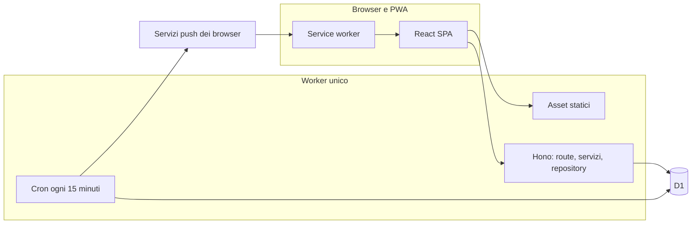

# Architettura

Stato: Fase 0, in attesa di approvazione. Nessun componente applicativo è stato scritto.

La piattaforma è una sola applicazione: PWA React servita come asset statici e API Hono sullo stesso Worker Cloudflare. Il database è un solo D1. Non ci sono code, bucket, KV o server di posta.

## Decisioni da approvare

Queste scelte condizionano sicurezza, costi o struttura. Il passaggio alla Fase 1 le considera accettate, salvo modifiche richieste ora.

1. **Password.** Il portale serve al massimo 15 persone e non contiene dati sensibili. La password ha almeno 16 caratteri e al massimo 128: una frase lunga, senza obblighi di maiuscole, numeri o simboli. Si rifiuta un breve elenco di password comuni. In database non si salva il testo: PBKDF2-SHA-256, 10.000 iterazioni fisse, sale casuale di 16 byte, hash di 32 byte. Il formato salvato è `pbkdf2-sha256$10000$sale$hash`. Diecimila iterazioni restano intorno ai 2 ms, dentro il limite di CPU del piano gratuito. La lunghezza è il controllo principale; l'hash impedisce di leggere la password dal database e obbliga chi copia il database a provare frase per frase.
2. **Niente email.** Invito e recupero password sono link monouso che l'amministratore consegna di persona o con un canale che l'associazione usa già. Il token sta nel frammento dell'URL, così non viaggia verso il server né finisce nei log della richiesta della pagina. Non si integra alcun servizio di posta, a pagamento o gratuito.
3. **Niente ORM.** I repository usano SQL parametrizzato sul binding D1. Meno strati, query ispezionabili, nessun generatore di schema accanto alle migrazioni SQL.
4. **Niente KV, R2, Queues, Durable Objects o Turnstile.** Il rate limiting e la coda push stanno su D1. Il backup è un file scaricato dall'amministratore. Il ripristino avviene con Wrangler, non con un pulsante nell'applicazione. Il Time Travel di D1, 7 giorni sul piano gratuito, copre gli errori recenti.
5. **Un ruolo globale.** `admin`, `coordinator` o `volunteer` sull'utente. Il perimetro di coordinatore e volontario è l'appartenenza ai gruppi, non un secondo ruolo per gruppo. Una persona non può coordinare un gruppo ed essere solo volontaria in un altro, a meno di cambiare questa decisione.
6. **Ricorrenze.** Calcolo con Temporal, abilitato dal flag `temporal`, fuso fisso `Europe/Rome`. L'orologio applicativo è `Date.now()`, iniettabile nei test. Il generatore inserisce soltanto, fino alla fine del mese successivo e comunque non oltre 62 giorni, al massimo 80 task per esecuzione. I giorni 29, 30 e 31 si accorciano sull'ultimo giorno del mese senza spostare l'ancora. Il 29 febbraio, negli anni comuni, diventa il 28. Il cambio ora usa la disambiguazione Temporal `compatible`: il buco di marzo avanza, l'ora doppia di ottobre prende il primo istante. Modificare una regola non riscrive le task già create.
7. **Push best-effort.** Il centro notifiche interno è il canale su cui si può contare. Le push partono a piccoli lotti dal cron, perché cifrare e inviare costa CPU e il cron gratuito ha lo stesso tetto di 10 ms. Su iPhone funzionano solo con la PWA installata e aperta dall'icona, da iOS 16.4, dopo un gesto esplicito. Non sono un canale di emergenza e non sostituiscono una telefonata.
8. **Radice del repository.** Il codice sta nella radice di `avis`, non in una sottocartella `volontari-app`. `index.html` resta nella radice perché Vite e il plugin Cloudflare se lo aspettano lì.
9. **Risorsa fuori perimetro.** La risposta è `404`, identica a «non esiste». Il `403` resta per un'azione vietata su una risorsa che la persona può già vedere.
10. **Chiusura checklist.** Un elemento obbligatorio deve essere conforme o non conforme. «Non applicabile» vale solo per i facoltativi. La non conformità permette di chiudere e resta visibile nello storico. Le esecuzioni chiuse sono copie: cambiare il modello non le modifica.
11. **Niente cancellazione fisica** di utenti, gruppi, task o esecuzioni completate. Si disattiva, si archivia o si annulla.
12. **Schema intero nella prima migrazione.** Le tabelle delle fasi 2–7 nascono subito, vuote. Si evitano alterazioni successive sulle tabelle già popolate. Il nome visualizzato predefinito è «Avis Berceto», modificabile nelle impostazioni.

## Contesto verificato

Fonti lette il 18 novembre 2026: documentazione Cloudflare su limiti Workers, prezzi Workers, prezzi e limiti D1, flag `temporal`, asset statici e SPA; documentazione Apple sulle Web Push; scheda di `@block65/webcrypto-web-push`.

| Risorsa               | Piano gratuito                                                                                           | Effetto sul progetto                                                                                                            |
| --------------------- | -------------------------------------------------------------------------------------------------------- | ------------------------------------------------------------------------------------------------------------------------------- |
| Richieste Worker      | 100.000 al giorno. Gli asset statici non consumano questa quota.                                         | Ampiamente sufficiente per 15 persone, se l'interfaccia non fa polling stretto.                                                 |
| CPU                   | 10 ms per richiesta HTTP e per cron.                                                                     | Il login, con 10.000 iterazioni, resta nel limite. Il tetto condiziona ancora l'invio push. Il tempo di attesa di D1 non conta. |
| Cron                  | Fino a 5 trigger per account, granularità minima un minuto, espressi in UTC.                             | Ne usiamo uno, ogni 15 minuti.                                                                                                  |
| D1 letture            | 5 milioni di righe al giorno. Dal 1 settembre 2026 il superamento blocca le query fino a mezzanotte UTC. | Dashboard e liste devono usare gli indici.                                                                                      |
| D1 scritture          | 100.000 righe al giorno, indici compresi.                                                                | Il volume reale è basso. Il polling e i contatori di sessione vanno limitati.                                                   |
| D1 storage            | 500 MB per database, 5 GB per account, 10 database.                                                      | Un solo database, occupazione prevista di pochi megabyte.                                                                       |
| Query per invocazione | 50 sul piano gratuito. Un `batch` conta come un'invocazione, non come una query per istruzione.          | Le operazioni multiple usano `batch`.                                                                                           |
| Subrequest            | 50 per invocazione, 6 connessioni in uscita contemporanee.                                               | Le push si inviano in serie, a lotti piccoli.                                                                                   |
| Time Travel           | 7 giorni.                                                                                                | Rete di sicurezza, non sostituto dell'export.                                                                                   |

Se una quota si esaurisce, il servizio gratuito rifiuta le richieste. Non scatta un addebito. Questo è il comportamento voluto.

Funzioni che il piano gratuito non garantisce:

- consegna push affidabile, immediata e disponibile anche senza installare la PWA;
- invio di email;
- esecuzione del cron al secondo, o un suo uso come allarme di emergenza;
- prova su telefoni fisici dall'ambiente di sviluppo dell'agente.

WhatsApp, store Apple, store Google, VPS e piani trial non fanno parte della soluzione.

## Componenti



Il browser chiede le pagine come navigazione: gli asset rispondono, e il fallback SPA restituisce `index.html`. Tutto ciò che inizia con `/api/` è configurato con `run_worker_first`, così un refresh su un endpoint non restituisce l'HTML dell'applicazione.

Il Worker esporta `fetch` e `scheduled`. Il cron e l'endpoint amministrativo di sblocco chiamano la stessa funzione `tick`.

```text
index.html
src/web/                React, route, pagine, componenti
src/worker/index.ts     ingresso fetch e scheduled
src/worker/app.ts       Hono
src/worker/routes/
src/worker/middleware/
src/worker/services/
src/worker/repositories/
src/worker/jobs/tick.ts
src/worker/security/
src/shared/schemas/     Zod condivisi
src/shared/domain/      stati, permessi, ricorrenze pure
public/                 manifest, icone, service worker
migrations/
tests/unit/
tests/integration/
tests/e2e/
```

La cartella `src/shared/domain` non parla con il database. Le ricorrenze e la macchina degli stati si provano senza Worker. I repository non conoscono HTTP. I servizi ricevono già dati validati e applicano permessi e transizioni.

Non si introduce un bus, un motore di plugin o un livello di dominio oltre questa separazione.

## Stack e dipendenze

Runtime di sviluppo: Node.js 22. `compatibility_date`: `2026-11-18`. Flag: `temporal`. `nodejs_compat` spento, finché nessuna dipendenza lo impone. Se una libreria lo richiede, si cerca prima un'alternativa su WebCrypto.

| Dipendenza                                      | Ruolo                  | Perché questa                                                                                                             |
| ----------------------------------------------- | ---------------------- | ------------------------------------------------------------------------------------------------------------------------- |
| `react`, `react-dom`                            | Interfaccia            | Richiesta, adatta alla PWA.                                                                                               |
| `react-router`                                  | Route client           | SPA con fallback sull'`index.html`.                                                                                       |
| `@tanstack/react-query`                         | Dati server            | Cache, ricaricamento al focus, niente stato duplicato a mano. `staleTime` di almeno 30 secondi per non bruciare la quota. |
| `react-hook-form`, `@hookform/resolvers`, `zod` | Moduli, dalla Fase 2   | `@hono/zod-validator` 0.9.1 accetta Zod 4. Si installano con il primo modulo, non prima.                                  |
| `tailwindcss` e `@tailwindcss/vite`             | Stile                  | Utility CSS, bundle unico, niente CSS-in-JS a runtime.                                                                    |
| `lucide-react`                                  | Icone                  | Set leggero, già previsto.                                                                                                |
| `vite`, `@vitejs/plugin-react`                  | Build                  | Tooling standard.                                                                                                         |
| `@cloudflare/vite-plugin`, `wrangler`           | Runtime locale e build | Un solo processo serve UI, Worker e D1 locale. È il percorso documentato da Cloudflare per una SPA con API.               |
| `hono`, `@hono/zod-validator`                   | HTTP                   | Piccolo, pensato per i Workers, middleware inclusi.                                                                       |
| `typescript` strict                             | Tipi                   | Configurazione rigorosa, niente `any` di comodo.                                                                          |
| `vitest`, `@cloudflare/vitest-plugin`           | Test                   | Unitari e integrazione sul runtime reale. Il pacchetto precedente `vitest-pool-workers` è deprecato.                      |
| `playwright`                                    | End-to-end             | Browser automatizzato, mobile e desktop.                                                                                  |
| `eslint`, `prettier`                            | Stile                  | Controllo in Fase 1.                                                                                                      |
| `@block65/webcrypto-web-push`                   | Push, dalla Fase 6     | WebCrypto, dichiarato compatibile con i Workers, senza il modulo Node `web-push`.                                         |

Librerie escluse:

| Libreria                                                          | Motivo                                                                                                              |
| ----------------------------------------------------------------- | ------------------------------------------------------------------------------------------------------------------- |
| `web-push`                                                        | Dipende da API Node. Anche con `nodejs_compat` non è la scelta più stabile.                                         |
| `bcrypt`, `@node-rs/argon2`, implementazioni Argon2 in JavaScript | Non stanno nei 10 ms, oppure non girano su Workers.                                                                 |
| Drizzle o un altro ORM                                            | Strato non necessario accanto a SQL già esplicito.                                                                  |
| Lucia e librerie di auth complete                                 | Il flusso è piccolo e specifico: invito, tre ruoli, cookie. Meno codice opaco.                                      |
| Luxon, date-fns, polyfill Temporal                                | Il runtime ha Temporal con il flag. Un polyfill in più pesa e, in passato, ha mascherato bug dell'orologio nativo.  |
| Cloudflare Queues, KV, R2                                         | Servizi aggiuntivi non necessari. KV gratuito ha poche scritture giornaliere, inadatto ai tentativi di login.       |
| Axios                                                             | `fetch` basta.                                                                                                      |
| Next.js, Remix, un UI kit completo                                | Più runtime e più superficie, senza un bisogno corrispondente. I componenti accessibili si scrivono sul caso d'uso. |

Le versioni installate in Fase 1 sono nel `package-lock.json`. Scelte di compatibilità: TypeScript 5.9.3, perché typescript-eslint non supporta TypeScript 6 o 7; Vite 8.3.8 con `@vitejs/plugin-react` 6; Vitest 5.1.1 con `@cloudflare/vitest-plugin` 1.8.4; React 19.3 con `@types/react` 19.3, perché il pacchetto React non include più i tipi. Playwright arriva con i test end-to-end.

Binding D1: `DB`. Nome Worker e database: `volontari`. Il `database_id` remoto si crea solo nella Fase 9.

Cron: `*/15 * * * *`. Novantasei invocazioni al giorno.

## Autenticazione

### Primo amministratore

`POST /api/setup` funziona solo se `users` è vuota. Confronta `BOOTSTRAP_TOKEN` in tempo costante, dopo aver calcolato il digest di entrambi i valori. Crea l'utente `admin` già `active` e apre la sessione. Poi l'endpoint risponde sempre `404`, anche se il token è corretto. `GET /api/setup` risponde solo `{ "initialized": true }` oppure `{ "initialized": false }`, così l'interfaccia sceglie tra primo avvio e accesso. Il token vive in `.dev.vars` in locale e come secret in produzione. Non sta nel codice. La sedicesima persona riceve `409`: il portale resta entro 15 utenti.

### Invito e recupero

L'amministratore crea l'utente `invited` e riceve una sola volta un URL del tipo `/attiva#<token>`. La pagina legge il frammento, lo toglie dalla barra con `replaceState` e lo spedisce nel corpo. Il server conserva SHA-256 del token. Scadenza invito: 7 giorni. Reset: 24 ore, stessa tabella, scopo diverso. All'accettazione si impostano hash e stato `active`, si marca il token e si apre la sessione.

Non esiste «password dimenticata» self-service. La persona lo chiede a un amministratore, che emette un nuovo link. È una limitazione voluta: senza posta non c'è un canale migliore che resti sotto il nostro controllo.

### Password

Minimo 16 caratteri, massimo 128. Il modulo chiede una frase di almeno 16 caratteri. Il server applica PBKDF2-SHA-256 a 10.000 iterazioni con un sale diverso per ogni utente. Se l'email non esiste, il login esegue comunque la stessa derivazione su un hash fisso, così il tempo di risposta non rivela se l'account c'è.

### Sessione

Token di 32 byte da `crypto.getRandomValues`. Cookie `volontari_session`. Nel database si salva solo l'hash SHA-256. Durata assoluta 14 giorni, inattività 12 ore. Il logout valorizza `revoked_at`. Login e cambio password creano un identificativo nuovo. La disattivazione revoca tutte le sessioni.

In locale, su `http://localhost`, il cookie non ha `Secure`. In produzione la richiesta è HTTPS e `Secure` è obbligatorio. `SameSite=Lax` copre la navigazione normale della PWA.

### Scritture

Oltre al cookie: metodo non safe, JSON, intestazione `X-Volontari-Request: 1`, `Origin` coincidente. Manca uno di questi controlli e la risposta è `403`. Un form di un altro sito non può aggiungere quell'intestazione senza un preflight CORS, e CORS non riflette origini arbitrarie. Non c'è un cookie CSRF separato: per una SPA sulla stessa origine sarebbe un secondo segreto con lo stesso compito.

### Rate limiting

Tabella `auth_attempts`. Login: 5 fallimenti in 15 minuti per SHA-256 dell'email e 20 per SHA-256 dell'IP osservato. Su Cloudflare l'IP è `CF-Connecting-IP`, non un'intestazione che il client possa falsificare verso il bordo. In locale la chiave di IP è fissa e resta attiva quella dell'email. Superata la soglia: `429` e nessun altro tentativo di hash. Il messaggio non dice se l'email esiste.

Anche setup, accettazione invito e reset hanno un limite, più largo, per evitare scansioni di token.

### Autorizzazione

Ogni repository di task, checklist, gruppi e calendario riceve l'utente e applica il filtro:

- amministratore: nessun filtro di gruppo, salvo quello chiesto;
- coordinatore e volontario: `group_id` tra i gruppi di `group_members`;
- notifiche, sessioni, sottoscrizioni: `user_id` dell'utente corrente, sempre.

Il volontario non crea task, non cambia assegnatari, non gestisce modelli, non sospende ricorrenze. Può prendere in carico una task del gruppo se è assegnata a lui o se non ha assegnatari, e può completarla se l'ha presa lui o se è assegnatario. Può avviare un modello attivo del gruppo e aggiornare le esecuzioni che ha avviato.

Il coordinatore fa tutto questo sui propri gruppi e in più crea, modifica, assegna, annulla, riapre, gestisce modelli e ricorrenze. Non tocca utenti, ruoli, impostazioni, audit ed export completo.

Le dashboard leggono gli stessi filtri. I conteggi sono query aggregate, non valori preparati nell'interfaccia.

Transizioni di task consentite:

| Da                     | A             | Chi                                                           |
| ---------------------- | ------------- | ------------------------------------------------------------- |
| `todo`                 | `in_progress` | Assegnatario, membro se la task è libera, coordinatore, admin |
| `in_progress`          | `todo`        | Chi l'ha presa, coordinatore, admin                           |
| `todo` o `in_progress` | `completed`   | Assegnatario, chi l'ha presa, coordinatore, admin             |
| `completed`            | `in_progress` | Coordinatore, admin                                           |
| `todo` o `in_progress` | `cancelled`   | Coordinatore, admin                                           |

`cancelled` non ha uscite nell'MVP.

## Interfaccia

Mobile first, italiano, colori sobri e contrasto pensato per un uso all'aperto. Barra inferiore: Home, Attività, Calendario, Checklist, Profilo. Icona notifiche nella testata, con il numero delle non lette. Su desktop la stessa mappa sta in una barra laterale; Amministrazione compare solo per l'amministratore.

Route: `/accedi`, `/attiva`, `/reimposta-password`, `/`, `/attivita`, `/attivita/:id`, `/calendario`, `/checklist`, `/checklist/modelli/:id`, `/checklist/esecuzioni/:id`, `/profilo`, `/notifiche`, `/amministrazione/utenti`, `/amministrazione/gruppi`, `/amministrazione/registro`, `/amministrazione/impostazioni`.

Ogni schermata ha caricamento, vuoto ed errore. Le azioni distruttive o irreversibili chiedono conferma: annullare una task, disattivare una persona, sospendere una regola cancellando le occorrenze future. I form mostrano l'errore sul campo. La tastiera raggiunge menu, dialoghi e azioni. Non ci sono dati dimostrativi nel database di produzione; i test creano i propri.

Il manifest, in Fase 1, usa `display: standalone` e `lang: it`, condizione necessaria perché su iOS 16.4–18 l'icona si apra come web app e non come segnalibro. Il service worker di push arriva in Fase 6. Fino ad allora la PWA è installabile ma non riceve push. Il service worker non mette in cache le risposte `/api`: una cache stale sul profilo o sulle task sarebbe un bug di autorizzazione.

Intestazioni di sicurezza sull'HTML e sulle API: `Content-Security-Policy` con `default-src 'self'`, script solo `'self'`, `frame-ancestors 'none'`, `base-uri 'self'`; `Referrer-Policy: no-referrer`; `X-Content-Type-Options: nosniff`; `Permissions-Policy` che chiude fotocamera, microfono e geolocalizzazione; HSTS solo in produzione.

## Job periodico

Ogni 15 minuti, in un ordine fisso e con limiti:

1. Genera le occorrenze mancanti, al massimo 80 inserimenti.
2. Crea le notifiche interne «in scadenza» e «scaduta» per le task aperte che rientrano nella finestra e non hanno già quella chiave.
3. Prende al massimo 5 consegne push scadute e le invia una alla volta.
4. Elimina sessioni vecchie, tentativi oltre 2 giorni, token scaduti da 90 giorni, notifiche oltre 180 giorni, consegne chiuse oltre 30 giorni.

Se la misurazione della Fase 6 mostra che una sola cifratura push supera in modo stabile i 10 ms, il lotto scende a 1. Se anche una consegna fa superare il limite in produzione, le push si fermano e il centro notifiche interno resta il canale funzionante. Non si cambia piano senza una decisione nuova.

Il cron può ritardare. Una scadenza è quindi visibile in applicazione anche se la push arriva al giro successivo.

## Log e audit

I log di console sono JSON: `requestId`, metodo, percorso, stato, durata, `userId` se c'è, codice errore. Non contengono email, nomi, password, cookie, token, endpoint push o corpi delle richieste.

L'audit è la memoria funzionale per gli amministratori ed è descritto in `DATABASE.md`. Si scrive nella stessa batch dell'operazione che lo produce.

## Rischi

| Rischio                           | Controllo                                                                                | Residuo                                                                                                                                                                                 |
| --------------------------------- | ---------------------------------------------------------------------------------------- | --------------------------------------------------------------------------------------------------------------------------------------------------------------------------------------- |
| Furto del database                | Password di almeno 16 caratteri, hash con sale, niente password in chiaro                | Con 10.000 iterazioni una frase corta o prevedibile resta indovinabile. Il minimo di 16 caratteri e l'assenza di registrazione pubblica sono il controllo accettato per questo portale. |
| Furto di sessione via XSS         | Cookie `HttpOnly`, CSP, niente HTML non fidato, React che escapa il testo                | Un XSS resta grave perché la pagina può chiamare l'API. La CSP e l'assenza di HTML libero riducono la superficie.                                                                       |
| CSRF                              | `SameSite=Lax`, Origin, intestazione custom, solo JSON                                   | Browser molto vecchi fuori dal perimetro della PWA.                                                                                                                                     |
| IDOR                              | Filtro di gruppo obbligatorio nei repository, test dedicati, `404` uniforme              | Un repository nuovo che dimentica il filtro. La revisione di ogni query di risorsa è parte della fase corrispondente.                                                                   |
| Enumerazione utenti               | Messaggio di login unico, hash fittizio se l'utente non esiste, token di invito generici | I tempi di D1 possono ancora differire di poco.                                                                                                                                         |
| SQL injection                     | Parametri e ordinamenti chiusi                                                           | Concatenazione vietata in revisione.                                                                                                                                                    |
| Formula injection nel CSV         | Apostrofo davanti a `=`, `+`, `-`, `@`                                                   | Un foglio di calcolo che ignora l'apostrofo.                                                                                                                                            |
| Token di invito inoltrato         | Scadenza breve, monouso, frammento URL, rate limit                                       | Chi possiede il link prima del destinatario può attivare l'account. L'amministratore lo consegna in modo diretto.                                                                       |
| Push come segreto                 | Endpoint non loggati; il backup che li contiene è riservato                              | Il file di backup va custodito come un segreto.                                                                                                                                         |
| Quota gratuita esaurita da un bug | Niente polling sotto i 30 secondi, job a lotti, indici                                   | Un ciclo difettoso può comunque saturare la giornata. Il sintomo è un `503`, non un costo.                                                                                              |
| Cron da 10 ms                     | Lotti, generatore puro testato a parte, push disattivabili di fatto                      | Le push possono restare in coda se la CPU non basta.                                                                                                                                    |
| iPhone senza installazione        | Testo in profilo che spiega di aggiungere alla Home                                      | Chi usa solo la scheda Safari non riceve push. Vede comunque le notifiche interne.                                                                                                      |
| Unico amministratore              | Il server impedisce di disattivarlo o di togliergli il ruolo se non ne resta un altro    | Se perde l'accesso, serve la procedura di reset da parte di chi controlla l'account Cloudflare, documentata in Fase 8.                                                                  |
| Dipendenze                        | Lockfile, niente librerie Node nel Worker, controllo prima dell'installazione            | Supply chain ordinaria, da aggiornare con giudizio.                                                                                                                                     |

## Copertura dei requisiti

| Requisito                                     | Dove si realizza                                                             | Fase                            |
| --------------------------------------------- | ---------------------------------------------------------------------------- | ------------------------------- |
| Utenti, ruoli, gruppi, invito, sessioni       | Modulo A, schema e API auth                                                  | 2                               |
| Dashboard sui dati reali                      | `GET /api/dashboard`                                                         | 3                               |
| Task, stati, assegnazioni, storico            | Modulo C e audit                                                             | 3                               |
| Calendario, ricorrenze, fusi, job             | Modulo D e `tick`                                                            | 5                               |
| Checklist con copie immutabili                | Modulo E                                                                     | 4                               |
| Notifiche interne e push                      | Modulo F                                                                     | 6                               |
| Audit consultabile, CSV, backup, impostazioni | Modulo G. Le scritture di audit partono appena esiste l'azione, dalla Fase 2 | 7 per le schermate e gli export |
| PWA installabile                              | Manifest in Fase 1, service worker in Fase 6, verifica di routing in Fase 8  | 1, 6, 8                         |
| Deploy gratuito                               | Preparazione Fase 8, pubblicazione Fase 9 solo su autorizzazione             | 8, 9                            |

La Fase 3 non invia notifiche. La tabella c'è, l'evento si collega in Fase 6. È una conseguenza dell'ordine richiesto, non una dimenticanza.

## Fuori dall'MVP

Analisi statistiche, email, WhatsApp, registrazione pubblica, più ruoli nello stesso gruppo, riapertura di una task annullata, modifica retroattiva delle occorrenze già generate, ripristino da interfaccia, cancellazione fisica, più lingue, più fusi orari, allegati.
