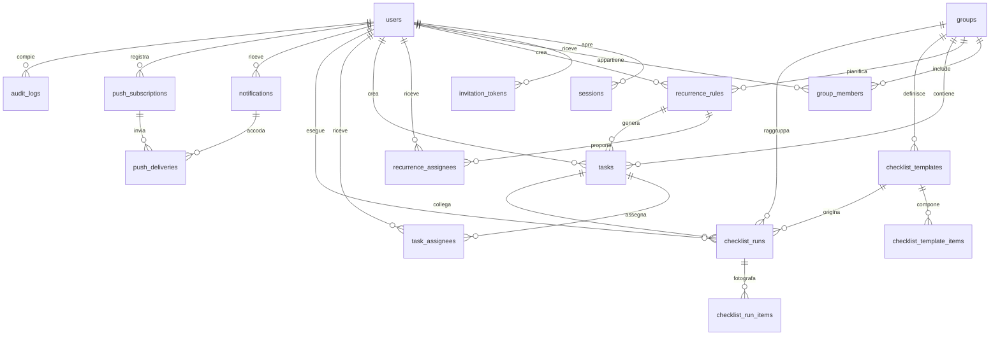

# Database

Il database è uno solo, Cloudflare D1, compatibile SQLite. Lo schema dell'MVP è in [`migrations/0001_init.sql`](migrations/0001_init.sql). Le tabelle delle fasi successive nascono già ora, vuote, per non dover alterare in seguito le tabelle centrali. Le migrazioni dopo la prima serviranno solo a correzioni.

Non esiste uno schema precedente nel repository: questo file è stato disegnato dai requisiti.

## Convenzioni

- Chiave primaria: UUID v4 generato con `crypto.randomUUID()`, salvato come `TEXT`.
- Istante: `INTEGER`, millisecondi Unix UTC. Non si salvano stringhe con fuso orario.
- Data di calendario: `TEXT` `YYYY-MM-DD`, sempre interpretata in `Europe/Rome`.
- Ora locale di una ricorrenza: `TEXT` `HH:MM` in `Europe/Rome`.
- Booleano: `INTEGER` con vincolo `0` o `1`.
- Enumerazioni: `CHECK` sul database e Zod sull'API. I due elenchi devono restare allineati.
- Email: trim e minuscolo in scrittura, con `UNIQUE COLLATE NOCASE` come rete di sicurezza.
- Query solo parametrizzate. `ORDER BY` solo da un elenco fisso di colonne, mai dal testo del client.
- Le scritture di una stessa operazione usano `db.batch()`, che su D1 è atomico.

D1 applica le chiavi esterne per impostazione predefinita. La migrazione non contiene `PRAGMA`. La Fase 1 deve dimostrare che un inserimento orfano fallisce.

## Diagramma

`auth_attempts` e `app_settings` sono tabelle tecniche, senza un legame funzionale con il diagramma. `app_settings.updated_by` punta a `users`.

## Tabelle

### `users`

Account creati solo da un amministratore, oppure il primo amministratore creato dalla procedura di avvio.

| Colonna         | Note                                                                                                                                                                           |
| --------------- | ------------------------------------------------------------------------------------------------------------------------------------------------------------------------------ |
| `role`          | `admin`, `coordinator`, `volunteer`. Un solo ruolo globale.                                                                                                                    |
| `status`        | `invited`, `active`, `disabled`                                                                                                                                                |
| `password_hash` | Nullo finché l'invito non è accettato. Formato `pbkdf2-sha256$10000$sale$hash`: PBKDF2-SHA-256, 10.000 iterazioni, sale casuale. La password in chiaro ha almeno 16 caratteri. |

Un utente `active` deve avere l'hash. Un utente `disabled` deve avere `disabled_at`. Il sale dentro l'hash è l'unico segreto per utente.

### `groups` e `group_members`

Un gruppo ha un nome univoco, senza distinzione di maiuscole. `archived` lo toglie dalle scelte nuove e lo lascia nello storico.

L'appartenenza è la coppia `(group_id, user_id)`. Non esiste un ruolo diverso dentro al gruppo: il ruolo globale e l'elenco dei gruppi determinano insieme che cosa una persona può fare.

### `sessions`

`id` è lo SHA-256 del token presente nel cookie, non il token. Il token grezzo non viene salvato.

`revoked_at` valorizza il logout. La pulizia periodica elimina le sessioni scadute o revocate da più di 30 giorni. L'inattività e la scadenza assoluta sono applicate in lettura: 12 ore dall'ultimo uso e 14 giorni dalla creazione. `last_seen_at` si aggiorna al massimo ogni 5 minuti.

### `invitation_tokens`

Un solo meccanismo per due scopi: `invite` (7 giorni) e `password_reset` (24 ore). Si salva solo lo SHA-256 del token. `used_at` rende il token inutilizzabile. Un nuovo token per lo stesso utente e scopo non cancella il precedente: tutti quelli non usati e non scaduti vengono rifiutati se ne esiste uno più recente, e l'accettazione marca quello presentato. La Fase 2, in più, marca come usati i token precedenti dello stesso scopo quando ne emette uno nuovo.

Il valore grezzo compare una sola volta nella risposta all'amministratore. Il link lo mette nel frammento (`#`), che il browser non invia al server.

### `recurrence_rules` e `recurrence_assignees`

| Campo                  | Uso                                                                                 |
| ---------------------- | ----------------------------------------------------------------------------------- |
| `frequency`            | `daily`, `weekly`, `monthly`, `yearly`                                              |
| `interval_count`       | Ogni N giorni, settimane, mesi o anni                                               |
| `weekdays`             | JSON, giorni ISO da 1 (lunedì) a 7, obbligatorio se settimanale                     |
| `day_of_month`         | Obbligatorio per mensile e annuale. È l'ancora, non il giorno effettivamente creato |
| `month_of_year`        | Obbligatorio per l'annuale                                                          |
| `local_time`           | Ora desiderata in `Europe/Rome`                                                     |
| `starts_on`, `ends_on` | Date locali inclusive                                                               |
| `suspended_at`         | Se valorizzato, il generatore ignora la regola                                      |

Gli assegnatari sono utenti reali, con chiave esterna. In generazione si copiano su `task_assignees` solo se in quel momento sono membri attivi del gruppo.

### `tasks` e `task_assignees`

Stati: `todo`, `in_progress`, `completed`, `cancelled`.

Priorità: `low`, `normal`, `high`, `urgent`.

`due_at` può essere nullo. Una task senza scadenza non diventa mai scaduta.

Il vincolo di completamento e quello di annullamento obbligano stato e colonne di chiusura a muoversi insieme. Il database rifiuta una task `completed` senza autore e istante.

`recurrence_rule_id` e `occurrence_local_date` sono entrambi nulli oppure entrambi presenti. L'indice unico parziale `(recurrence_rule_id, occurrence_local_date)` impedisce due occorrenze dello stesso giorno locale. `ON DELETE SET NULL` sulla regola, da solo, violerebbe il `CHECK` se una regola venisse cancellata: l'applicazione non cancella le regole, le sospende. Il vincolo è voluto.

`recurrence_detached = 1` segnala che la riga è stata modificata a mano. Il generatore è comunque solo in inserimento, quindi non riscrive né le righe staccate né le altre.

### Checklist

`checklist_templates` e `checklist_template_items` sono il modello modificabile. `status = inactive` impedisce nuovi avvii e lascia consultabili le esecuzioni.

`checklist_runs` copia titolo e descrizione. `checklist_run_items` copia etichetta, aiuto, obbligatorietà e posizione. `source_item_id` è un riferimento informativo, senza chiave esterna: la voce del modello può sparire senza toccare lo storico.

Risultati di voce: `pending`, `compliant`, `non_compliant`, `not_applicable`.

Esito dell'esecuzione, calcolato solo alla chiusura: `compliant` se nessuna voce è `non_compliant`, altrimenti `non_compliant`.

`task_id` è opzionale. Se la task viene cancellata fisicamente il collegamento si azzera; l'applicazione però non cancella le task.

`task_checklists` collega un modello a un'attività, nello stesso gruppo. Chi vede l'attività vede le checklist da eseguire. L'attività non si può concludere finché ogni modello collegato non ha un'esecuzione `completed` di quell'attività. L'esito può essere conforme o non conforme: in entrambi i casi i controlli sono stati fatti.

L'unicità `(template_id, position)` e `(run_id, position)` rende delicato il riordino. Il servizio, dentro un batch, sposta prima le posizioni su valori negativi temporanei e poi scrive l'ordine finale.

### Notifiche e push

`notifications` è il canale certo. L'unicità `(user_id, type, resource_id, dedup_key)` impedisce i duplicati. Esempi di `dedup_key`: `assigned`, `due-soon`, `overdue`.

`push_subscriptions` conserva endpoint e chiavi del dispositivo. Sono segreti di canale: non finiscono nei log.

`push_deliveries` è la coda. Unicità `(notification_id, subscription_id)`. Stati: `pending`, `sent`, `failed`, `abandoned`. Al massimo 3 tentativi. Un `404` o `410` del servizio push elimina la sottoscrizione e marca la consegna `abandoned`. `429` e gli errori `5xx` incrementano `attempts` e spostano `next_attempt_at` di 15 minuti, poi 1 ora, poi 6 ore.

### `audit_logs`

Azioni rilevanti, non le letture. `metadata` è JSON compatto, al massimo 4 KB, senza password, token, cookie o chiavi push. Si salva l'id dell'attore; nome ed email si rileggono da `users` finché l'account esiste. Se un giorno l'account fosse rimosso a mano, `actor_id` diventa nullo e il testo dell'evento resta.

Azioni previste: `user.created`, `user.updated`, `user.disabled`, `user.enabled`, `invite.issued`, `password.reset_issued`, `password.changed`, `group.created`, `group.updated`, `membership.added`, `membership.removed`, `task.created`, `task.updated`, `task.claimed`, `task.released`, `task.completed`, `task.reopened`, `task.cancelled`, `recurrence.created`, `recurrence.updated`, `recurrence.suspended`, `recurrence.resumed`, `checklist_template.saved`, `checklist_run.started`, `checklist_run.completed`, `settings.updated`, `export.tasks`, `export.backup`.

### `auth_attempts` e `app_settings`

`auth_attempts` sostiene il rate limiting senza Cloudflare KV. `subject_hash` è lo SHA-256 dell'email normalizzata o dell'IP, così il database non accumula indirizzi in chiaro. Le righe più vecchie di 2 giorni si eliminano nel job.

`app_settings` contiene solo parametri operativi. Le 10.000 iterazioni e il minimo di 16 caratteri stanno nel codice, non in questa tabella.

Valori iniziali: nome associazione `Avis Berceto`, preavviso scadenza 24 ore, sessione inattiva 12 ore, sessione assoluta 14 giorni, invito 168 ore, reset 24 ore, 5 tentativi di login in 15 minuti.

## Integrità referenziale e cancellazioni

| Dato                 | Comportamento dell'applicazione                                                                  | Comportamento del database se qualcuno forza una `DELETE`                                                                                  |
| -------------------- | ------------------------------------------------------------------------------------------------ | ------------------------------------------------------------------------------------------------------------------------------------------ |
| Utente               | Disattivazione. Sessioni revocate. Nessuna rimozione.                                            | `RESTRICT` su task, checklist, audit storico e assegnazioni. `CASCADE` su sessioni, inviti, appartenenze, notifiche e sottoscrizioni push. |
| Gruppo               | Archiviazione. Le task restano consultabili da un amministratore.                                | `RESTRICT` se esistono task, regole o checklist. `CASCADE` sulle appartenenze.                                                             |
| Appartenenza         | Rimozione della riga. Le assegnazioni già fatte restano, ma la persona non entra più nel gruppo. | Cancellazione esplicita della riga di membership.                                                                                          |
| Sessione             | Logout: `revoked_at`. Pulizia fisica dopo 30 giorni.                                             | `CASCADE` se l'utente venisse cancellato.                                                                                                  |
| Token di invito      | Monouso. Pulizia dei token scaduti da 90 giorni.                                                 | `CASCADE` con l'utente.                                                                                                                    |
| Task                 | Annullamento, mai `DELETE`.                                                                      | `CASCADE` degli assegnatari. `SET NULL` sul collegamento della checklist.                                                                  |
| Regola ricorrente    | Sospensione.                                                                                     | `RESTRICT` finché una task la cita.                                                                                                        |
| Modello checklist    | Disattivazione.                                                                                  | `RESTRICT` se esistono esecuzioni. `CASCADE` delle voci di modello.                                                                        |
| Esecuzione checklist | Resta nello storico. L'annullamento di una bozza mette `cancelled`.                              | `CASCADE` delle voci di esecuzione.                                                                                                        |
| Notifica             | Conservazione 180 giorni, poi pulizia.                                                           | `CASCADE` con l'utente e verso le consegne push.                                                                                           |
| Sottoscrizione push  | Rimossa se il servizio risponde `404` o `410`, oppure se l'utente la disattiva.                  | `CASCADE` delle consegne.                                                                                                                  |
| Consegna push        | `sent` e `abandoned` conservati 30 giorni.                                                       | `CASCADE` con notifica o sottoscrizione.                                                                                                   |
| Audit                | Conservato. Nessuna pulizia nell'MVP: il volume di 15 persone resta piccolo.                     | L'attore diventa nullo, la riga resta.                                                                                                     |
| Tentativi di login   | Pulizia oltre 2 giorni.                                                                          | Nessuna chiave esterna.                                                                                                                    |

Le disattivazioni non riscrivono il passato. Una task completata continua a mostrare il nome dell'utente che l'ha chiusa, anche se oggi è disattivato.

## Ricorrenze

Il generatore è idempotente e solo in inserimento.

1. Considera le regole con `suspended_at` nullo e `starts_on` già raggiunto.
2. Calcola le date locali dalla più recente tra `starts_on` e oggi, fino al minore tra la fine del mese successivo, `ends_on` e oggi più 62 giorni.
3. Legge le `occurrence_local_date` già presenti per quella regola.
4. Inserisce solo le date mancanti, comprese quelle la cui task è stata annullata o modificata. Una data già presente non viene ricreata.
5. Copia gli assegnatari ancora validi.
6. Si ferma a 80 inserimenti per esecuzione. Il tick successivo continua. L'indice unico copre il caso di due esecuzioni sovrapposte: il conflitto si tratta come successo.

Modificare la regola non aggiorna le task già create. La schermata deve dirlo. Modificare una task esistente non tocca le sorelle né la regola.

Sospensione: non genera nuove date. Le task future già create restano, salvo che la richiesta chieda `cancelFutureOpen`. In quel caso si annullano solo le occorrenze `todo` o `in_progress` con data locale successiva a oggi, e si scrive l'audit.

### Calendario e cambi di ora

La conversione usa `Temporal.ZonedDateTime` con fuso `Europe/Rome` e `disambiguation: 'compatible'`.

- Giorno inesistente, passaggio all'ora legale: l'orario avanza della durata del buco. Il 29 marzo 2026 alle 02:30 diventa le 03:30, cioè le 01:30 UTC.
- Ora ambigua, ritorno all'ora solare: si sceglie l'istante precedente. Il 25 ottobre 2026 alle 02:30 vale le 00:30 UTC, quando in Italia sono ancora le 02:30 dell'ora legale.
- Giorno 31 mensile: si usa il giorno di ancora, limitato all'ultimo giorno del mese. Dal 31 gennaio si ottiene il 28 o 29 febbraio e di nuovo il 31 marzo. Non si trascina il giorno già accorciato.
- 29 febbraio annuale: negli anni non bisestili diventa il 28 febbraio. L'ancora resta 29.

`Temporal.Now` non è la fonte del tempo. Il job riceve `Date.now()` e i test iniettano un orologio fisso. Il flag `temporal` abilita il calendario; non si usa il suo orologio.

Il cron di Cloudflare è in UTC. La finestra di generazione no: è calcolata in `Europe/Rome`.

## Indici e limiti di piano

Gli indici coprono le query della dashboard, dei filtri task, del calendario, delle notifiche non lette, della coda push e del rate limit. D1 conta anche la scrittura sull'indice come riga scritta. Per questa dimensione il costo resta lontano dal tetto di 100.000 righe scritte al giorno.

Il tetto di 50 query per invocazione sul piano gratuito si rispetta raggruppando le letture e usando `batch` per le scritture multiple. La dashboard non fa una query per ogni riquadro: usa poche query aggregate, filtrate per i gruppi autorizzati.

La dimensione massima di un database D1 sul piano gratuito è 500 MB. Questo archivio, per 15 persone, resta nell'ordine dei megabyte.

## Backup

L'esportazione JSON, riservata all'amministratore, include utenti e hash delle password, gruppi, appartenenze, task, ricorrenze, checklist, notifiche, sottoscrizioni push, impostazioni e audit. Esclude sessioni, token di invito, tentativi di login e consegne push transitorie.

Il file va custodito: contiene gli hash delle password e gli endpoint push. Viaggia con `Cache-Control: no-store` e produce una riga di audit.

Il ripristino non è un endpoint HTTP. In locale si esegue con `node scripts/restore-local.ts copia.json directory`, che applica le migrazioni e le righe con Wrangler `--local` su una directory vuota, senza toccare il database in uso. Il Time Travel di D1 (7 giorni sul piano gratuito) per gli errori recenti entra nella documentazione di deploy della Fase 8.
